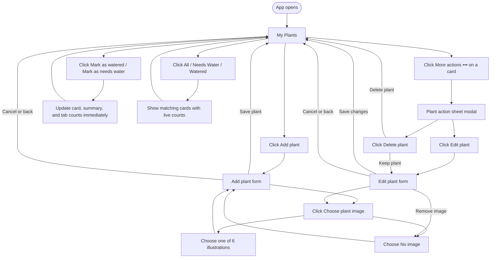
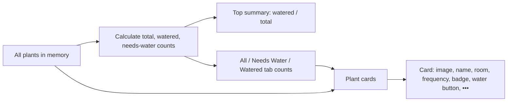
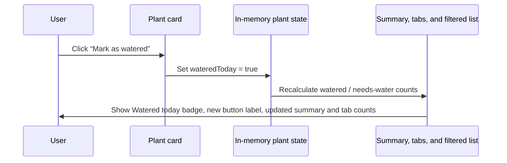

# Leaflet — App Flow Diagram

This is a standalone explanation of how the app works. It supplements the challenge brief and does not change it.

## What “watering frequency” means

**Watering frequency** is the normal number of days a plant should go between waterings.

Examples:

| Value | Meaning shown on the card |
|---|---|
| `2` days | `every 2 days` |
| `7` days | `every 7 days` |
| `14` days | `every 14 days` |

It is information about the plant's care routine. In this challenge, it is **displayed on the plant card only**. It does not automatically change a plant to “Needs water”, calculate dates, schedule notifications, or require a calendar. The user controls the current **Watered today / Needs water** status by clicking the water-status button.

Watering frequency must be a whole number of days greater than zero. The `−` and `+` controls decrease or increase it by one day.

## Plant data

Each plant can be represented with these in-memory fields:

| Field | Example | Purpose |
|---|---|---|
| `id` | `"monstera"` | A stable unique identifier. |
| `name` | `"Monstera"` | The card and form title. |
| `room` | `"Living Room"` | Where the plant lives. |
| `wateringFrequencyDays` | `7` | The number displayed as `every 7 days`. |
| `wateredToday` | `true` | Controls the badge, status button, summary, and filter counts. |
| `imageKey` | `"monstera"` or `null` | The selected bundled illustration, or no image. |

All plant data lives in React state for the current session. Refreshing the page restores the six default plants.

## Main navigation flow

## Home-page behavior

### Water-status toggle

The reverse path is identical: clicking **Mark as needs water** sets `wateredToday` to `false` and immediately updates all dependent UI.

## Add-plant flow

1. On **My Plants**, click **Add plant**.
2. Optionally click **Choose plant image**.
3. In the image picker, select one of these choices:
   - No image
   - Monstera
   - Snake Plant
   - Basil
   - Aloe Vera
   - Boston Fern
   - Succulent Trio
4. Enter a plant name (text `<input>`).
5. Select a room (`<select>`).
6. Set watering frequency in days (`−` / `+` buttons around a number field). For example, `7` means the card displays `every 7 days`.
7. Set whether the plant has been watered today (toggle switch).
8. Click **Save plant**. The new card appears immediately, and the summary and filter counts update.

If **No image** is selected, the plant is still created. Its card uses the neutral no-image placeholder.

## Edit-plant flow

1. On a card, click **More actions** (`•••`).
2. Click **Edit plant**.
3. Change any of the following:
   - plant image or no image
   - name
   - room
   - watering frequency
   - watered-today status
4. Click **Save changes** to apply the changes immediately.
5. Click **Cancel**, the in-page back link, or the browser back button to discard unsaved edits.

## Delete-plant flow

1. Open a plant's **More actions** menu.
2. Click **Delete plant**.
3. In the confirmation dialog (custom modal):
   - Click **Keep plant** to return without deleting anything.
   - Click **Delete plant** to remove it from in-memory state.
4. After deletion, remove the card immediately and recalculate the summary and tab counts.

## Filter behavior

| Selected tab | Cards shown |
|---|---|
| All | Every plant. |
| Needs Water | Plants where `wateredToday` is `false`. |
| Watered | Plants where `wateredToday` is `true`. |

The count in every tab always describes the full current set of plants, not just the cards visible in the selected tab.

## Empty state

When the plant array is empty:

1. Keep the title, summary (`0/0`), and filter tabs visible.
2. Show the **No plants yet** message and `src/assets/plants/empty-state-plant.png`.
3. Show an **Add your first plant** button that opens the same Add plant flow.
